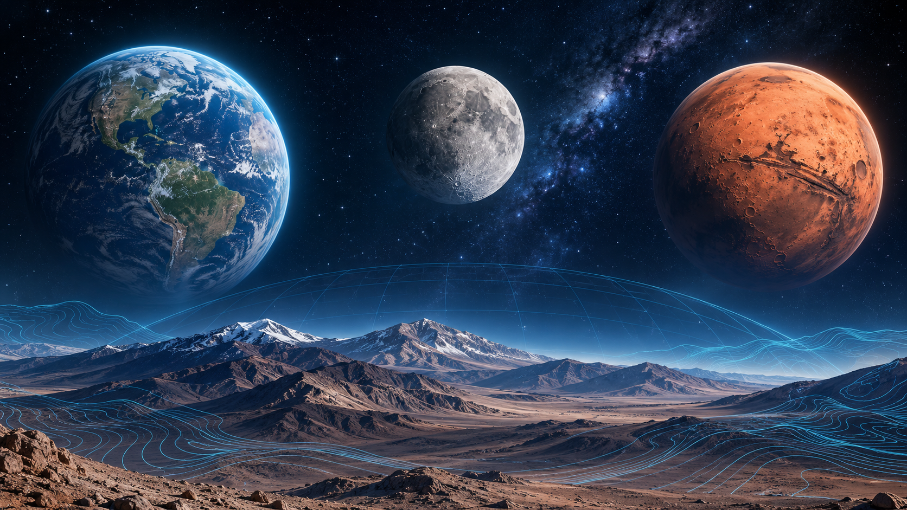

<p align="center">
  
</p>

<h1 align="center">🌍 Earth2Moon</h1>

<h3 align="center">
  AI-Powered Space Analog Site Finder
</h3>

<p align="center">
  <em>Find Earth. Explore Beyond.</em>
</p>

<p align="center">
  <strong>Find Earth. Explore Beyond.</strong>
  <br />
  Discover Earth's most promising terrain analogs for future Moon and Mars exploration.
</p>

<p align="center">
  
  
  
  
</p>

---

<p align="center">
  <a href="https://vision-x-gdse.onrender.com/">
    <strong>🚀 Live Demo</strong>
  </a>
</p>

## 🚀 Overview

**Earth2Moon** is an AI-assisted geospatial platform developed by **Vision-X** to identify and rank potential Earth-based analog sites that resemble selected regions of the Moon and Mars.

By combining real NASA elevation datasets, terrain analysis, machine learning, and explainable similarity scoring, Earth2Moon helps researchers explore terrestrial environments that may support the testing of space exploration technologies.

Rather than simply identifying similar-looking landscapes, the platform measures terrain characteristics, evaluates mission-specific requirements, and explains both the similarities and differences between locations.

**Our goal:** Make planetary terrain comparison more accessible, transparent, and data-driven.

## ✨ Key Features

| Feature | Description |
|---|---|
| 🌍 Planetary Exploration | Explore selected regions of the Moon and Mars alongside Earth locations. |
| 🛰️ NASA Data Integration | Analyze real LOLA, MOLA, and NASADEM elevation datasets. |
| 🧠 Terrain Similarity Analysis | Rank Earth locations using mission-specific weighted terrain comparisons. |
| 🤖 Machine Learning | Discover terrain patterns through K-means clustering and nearest-neighbor analysis. |
| 🗺️ Interactive Maps | Visualize candidate locations, terrain distributions, and similarity heatmaps. |
| 📊 Explainable Results | Understand why a location matches and where its terrain differs. |
| 🎯 Mission-Based Analysis | Evaluate terrain according to selected exploration objectives. |
| ✍️ AI-Generated Summaries | Generate readable site reports using Claude, OpenAI, or Gemini. |
| 🔬 Scientific Transparency | Display data coverage, uncertainty, resolution limitations, and unavailable features. |

## 🪐 How It Works

Earth2Moon follows a five-step analysis workflow:

1. **Select a Planetary Body** — Choose the Moon or Mars.
2. **Choose a Target Region** — Select a planetary location for comparison.
3. **Define a Mission Objective** — Choose the exploration objective.
4. **Configure Terrain Features** — Select available features and optionally adjust their weights.
5. **Run the Analysis** — Compare terrain measurements, rank Earth candidates, and explore the results.

### Analysis Pipeline

```text
NASA Planetary Data + NASADEM
              │
              ▼
       Data Processing
              │
              ▼
    Terrain Feature Extraction
              │
              ▼
      Scale Harmonization
              │
              ▼
    ┌──────────────────────┐
    │  Similarity Scoring  │
    │  K-means Clustering  │
    │  Nearest Neighbors   │
    └──────────────────────┘
              │
              ▼
     Candidate Ranking
              │
              ▼
    Interactive Results
              │
              ▼
       AI Site Summary
```

## 🛰️ NASA Data Sources

Earth2Moon currently processes three real elevation datasets:

| Planet | Dataset | Resolution | Coverage |
|---|---|---|---|
| 🌙 Moon | LRO LOLA Gridded DEM | 40 m | Lunar South Pole (85°S–90°S) |
| 🔴 Mars | MGS MOLA MEGDR | ~1.85 km | Global |
| 🌍 Earth | NASADEM_HGT v001 | ~30 m | Atacama Desert |

### Current Analysis Coverage

- **Moon:** Shackleton crater interior, Shackleton's rim near the South Pole, and two automatically selected terrain windows.
- **Mars:** Curiosity, Perseverance, and Opportunity landing sites.
- **Earth:** One NASADEM tile covering part of the Atacama Desert.

The Atacama dataset is divided into overlapping analysis windows:

- 399 Earth windows at a 10 km analysis scale for lunar comparisons.
- 72 Earth windows at a 30 km analysis scale for Mars comparisons.

Results are visualized through interactive maps and heatmaps.

### Scale Harmonization

To ensure meaningful comparisons, planetary and Earth datasets are processed on shared grids:

- **Moon vs. Earth:** LOLA 40 m and NASADEM resampled to 40 m.
- **Mars vs. Earth:** MOLA ~1.85 km and NASADEM area-averaged to the same resolution.

Mars comparisons are therefore regional-scale analyses, not rover-scale terrain assessments. Roughness is unavailable at this scale, and confidence is capped at medium.

## 🧠 Machine Learning & AI

Earth2Moon combines weighted similarity scoring with two complementary data-driven methods:

- **K-means Clustering:** An unsupervised learning method that groups terrain windows based on standardized features.
- **Nearest-Neighbor Search:** Ranks Earth terrain windows by their feature-space distance from the selected planetary target.
- 
### 1. K-Means Terrain Clustering

- Implemented using scikit-learn.
- Groups planetary and Earth terrain windows according to standardized features.
- Uses log-scaled relief measurements.
- Automatically selects the number of clusters using silhouette scores.
- Currently uses k = 3 for both analysis scales.

| Analysis Scale | Clusters | Silhouette Score |
|---|---:|---:|
| Moon | 3 | 0.46 |
| Mars | 3 | 0.47 |

### 2. Nearest-Neighbor Search

- Implemented using NumPy.
- Ranks Earth terrain windows according to their feature-space distance from the selected planetary target.
- Uses standardized terrain features with equal feature weights.

### 3. Model Agreement

The platform evaluates agreement between the two ranking approaches using:

- Top-10 overlap.
- Spearman rank correlation.

Rover-mobility tests produced Spearman correlations of 0.95–0.99, with 6–9 shared locations among the top 10 candidates.

> These are prototype evaluation results, not independent scientific validation.

### 4. AI-Generated Site Summaries

Each site report can include an AI-generated explanation based on its computed measurements.

Supported providers:
- Anthropic Claude
- OpenAI
- Google Gemini

**AI reliability safeguards:**
- Site facts are recomputed on the server.
- Generated numerical claims are validated against the underlying report data.
- Summaries are cached to avoid unnecessary repeated API calls.
- A configurable daily request limit protects API usage.
- AI summaries are optional and do not affect the core terrain analysis.

## 📊 Similarity Scoring

Earth2Moon uses a weighted similarity model:

`S = 100 × Σ (wᵢ × sᵢ)`

Where:
- `S` represents the overall similarity score.
- `wᵢ` represents the normalized weight of each selected feature.
- `sᵢ` represents the similarity of that feature, ranging from 0 to 1.

The scoring system includes:

- Gaussian similarity kernels for numerical features.
- Log-ratio comparison for terrain relief.
- Resolution-aware feature eligibility.
- Missing-data reporting and coverage calculations.
- Conservative ranking using lower-bound scores.
- Mission-specific feature requirements.

Scores are withheld when feature coverage falls below 60% or when a mission-required feature cannot be compared.

All weights, tolerances, and similarity kernels are currently prototype parameters awaiting further calibration.

## 🖥️ Platform Pages

| Route | Description |
|---|---|
| `/` | Project introduction, workflow, mission objectives, and data sources. |
| `/app` | Overview dashboard and recent analysis activity. |
| `/app/explore` | Five-step planetary terrain analysis workflow. |
| `/app/results/:id` | Ranked candidates, maps, charts, and uncertainty ranges. |
| `/app/results/:id/site/:siteId` | Detailed site comparison and scientific report. |
| `/app/atlas` | Searchable atlas of candidate locations. |
| `/app/saved` | Saved sites and local analysis history. |
| `/app/methodology` | Data sources, feature definitions, and scoring methodology. |
| `/app/limitations` | Scientific limitations and comparison boundaries. |
| `/app/about` | Project overview, technologies, roadmap, and credits. |

## 🛠️ Technology Stack

| Category | Technologies |
|---|---|
| Frontend | React 19, TypeScript, Vite |
| Styling | Tailwind CSS v4 |
| Backend | Python 3.11+, FastAPI |
| Data Processing | NumPy |
| Machine Learning | scikit-learn |
| Maps | Leaflet |
| Visualization | Recharts, Custom SVG |
| Storage | Browser localStorage, JSON |
| Deployment | Docker, Render |
| Planetary Data | NASA LOLA, MOLA, NASADEM |

## 🏗️ Project Architecture

```text
Vision-X/
│
├── backend/
│   └── app/
│       ├── engine/
│       │   ├── features.py
│       │   ├── missions.py
│       │   ├── similarity.py
│       │   ├── ml.py
│       │   ├── explain.py
│       │   └── bodies.py
│       │
│       ├── pipeline/
│       │   ├── readers.py
│       │   ├── terrain.py
│       │   ├── build.py
│       │   └── clustering.py
│       │
│       ├── providers/
│       ├── services/
│       ├── data/
│       ├── api.py
│       └── main.py
│
├── frontend/
│   ├── src/
│   │   ├── components/
│   │   ├── pages/
│   │   └── lib/
│   │
│   └── public/
│       ├── terrain/
│       └── textures/
│
├── Dockerfile
├── render.yaml
└── README.md
```

## ⚙️ Getting Started

### Prerequisites

- Python 3.11+
- Node.js 20+
- npm

### Installation

**1. Clone the repository**

```bash
git clone https://github.com/sadeemalm2005/Vision-X.git
cd Vision-X
```

**2. Start the backend**

```bash
cd backend
python -m venv .venv
```

Windows:

```bash
.venv\Scripts\activate
```

macOS / Linux:

```bash
source .venv/bin/activate
```

Install dependencies and start the API:

```bash
pip install -r requirements.txt
uvicorn app.main:app --reload --port 8000
```

**3. Start the frontend**

Open a second terminal:

```bash
cd frontend
npm install
npm run dev
```

**4. Open the application**

- Frontend: http://localhost:5173
- Backend API: http://127.0.0.1:8000
- API Documentation: http://127.0.0.1:8000/docs

### Rebuilding NASA Data

Processed terrain features and hillshade images are included in the repository, so the application can run without downloading the original raw datasets.

To rebuild the processed data:

1. Extract the NASA datasets into `backend/data/raw/NASA-DATA`.
2. Extract the NASADEM tile inside the Earth dataset directory.
3. Run:

```bash
cd backend
python -m app.pipeline.build --raw data/raw/NASA-DATA
```

The original raw datasets are approximately 375 MB and are not included in Git.

## 🧪 Testing

Run the backend tests:

```bash
cd backend
pip install -r requirements-dev.txt
python -m pytest
```

Run frontend tests:

```bash
cd frontend
npx vitest run
```

Build the frontend:

```bash
npm run build
```

The project currently includes 65 backend tests covering terrain calculations, data readers, machine learning, similarity scoring, and API behavior.

## 🌐 Deployment

Earth2Moon supports single-service deployment through Docker and Render.

The Dockerfile builds the frontend and serves the application through the FastAPI backend.

To deploy:

1. Connect your GitHub account to [Render](https://render.com).
2. Select **New → Blueprint**.
3. Choose the Vision-X repository.
4. Allow Render to read `render.yaml`.
5. Click **Apply**.

The application will be deployed to a public Render URL.

> Note: Render's free tier may put inactive services to sleep. The first request after inactivity can take additional time to load.

## 🔐 AI Configuration

AI summaries are optional. The core platform works without an AI API key.

Set one of the following environment variables:

| Provider | Environment Variable |
|---|---|
| Claude | `ANTHROPIC_API_KEY` |
| OpenAI | `OPENAI_API_KEY` |
| Gemini | `GEMINI_API_KEY` |

To select a provider:

```bash
EARTH2MOON_AI_PROVIDER=anthropic
```

For OpenAI, configure the model:

```bash
EARTH2MOON_AI_MODEL=YOUR_MODEL_NAME
```

For Claude, the default model is `claude-opus-5-5`; a lower-cost option can be selected using `claude-haiku-5-5`.

For Gemini, the latest stable Flash model available to the configured key is selected automatically by default.

Never commit API keys or secrets to the repository.

## ⚠️ Scientific Limitations

Earth2Moon is a terrain-comparison and research-discovery prototype.

Earth cannot fully reproduce the environmental conditions of the Moon or Mars. Terrain similarity does not establish geological, atmospheric, thermal, or operational equivalence.

The following features are not currently available:

| Feature | Required Data or Processing |
|---|---|
| Crater Morphology | Crater detection and analysis |
| Rock Distribution | Sub-meter imagery |
| Geological Classification | Geological maps |
| Regolith Proxies | Material or spectral datasets |

Consequently, crater-navigation and geological-research missions remain locked.

Additional Earth locations, including Death Valley, Meteor Crater, Hawaii, and Iceland, are planned but are not currently scored because their elevation tiles have not yet been integrated.

### Future Improvements

- Integrate additional NASADEM elevation tiles.
- Expand Earth analog-site coverage.
- Incorporate higher-resolution planetary elevation datasets.
- Add geological and crater-related analysis.
- Improve terrain feature availability.
- Calibrate scoring weights and tolerances.
- Conduct sensitivity and ablation testing.
- Validate results through expert review and reference cases.

## 👥 Team Vision-X

Earth2Moon is developed by **Vision-X**.

| Team Member |
|---|
| Sadeem Almohsen |
| Hayat Mohammed |
| Renad Algumaei |
| Raghad Aldroubi |
| Khulood Al-Jaberi |

## 🙏 Credits & Data Acknowledgments

We acknowledge the scientific missions and organizations whose publicly available datasets and imagery support this project:

- **NASA Lunar Reconnaissance Orbiter (LRO) – LOLA**
- **NASA Mars Global Surveyor (MGS) – MOLA**
- **NASADEM – NASA Earthdata**
- NASA Blue Marble via NASA GIBS.
- LRO WAC mosaic (NASA/GSFC/ASU).
- Viking MDIM 2.1 and MOLA shaded relief via NASA Solar System Treks.
- Earth basemaps © Esri and partners, © OpenStreetMap contributors, © CARTO.

Earth2Moon is an independent project and is not affiliated with, endorsed by, or officially associated with NASA.

---

<p align="center">
  <strong>🌍 Earth2Moon — Find Earth. Explore Beyond.</strong>
  <br />
  Built by Vision-X 🚀
</p>
